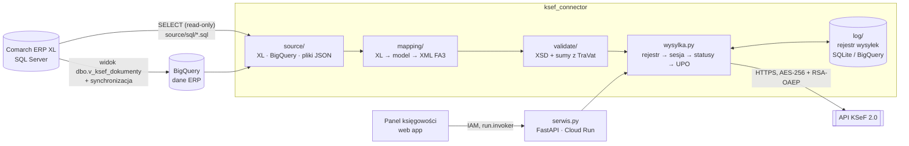

# ksef-connector — Comarch ERP XL → KSeF 2.0

Konektor, który wysyła faktury sprzedaży z **Comarch ERP XL** do **Krajowego Systemu e-Faktur (KSeF 2.0)** z pominięciem wbudowanej integracji ERP. Czyta bazę XL wyłącznie do odczytu, buduje XML w schemie **FA(3)**, waliduje go, szyfruje i wysyła przez API Ministerstwa Finansów, a wynik (numer KSeF, UPO) zapisuje we własnym rejestrze.

Projekt powstał jako rozwiązanie produkcyjne dla firmy, której wersja XL przestała komunikować się z KSeF. Działa na produkcji i obsługuje codzienną wysyłkę oraz zaległości. To repozytorium jest **zanonimizowaną wersją publiczną**: dane firmy przeniesiono do konfiguracji, a testy działają na danych fikcyjnych.

> 🇬🇧 **In short:** a production Python connector that reads invoices from a Comarch ERP XL (SQL Server) database, maps them to Poland's national e-invoice schema FA(3), validates against the official XSD, encrypts (RSA-OAEP + AES-256) and sends them to the KSeF 2.0 API. It includes duplicate protection, XL ↔ KSeF reconciliation, a BigQuery-backed audit log and a small HTTP service deployed on Cloud Run for the accounting team's web panel. 180+ tests, no real data in the repo.

---

## Co robi

- **Mapowanie XL → FA(3):** faktury sprzedaży (FS), eksportowe / WDT w walucie (FSE), zaliczkowe (FSL → `ZAL`), rozliczające zaliczkę (`ROZ`) i korekty (FSK → `KOR`).
- **Walidacja przed wysyłką:** XML zawsze sprawdzany oficjalnym XSD FA(3), a sumy pozycji porównywane z podsumowaniem VAT z ERP (`TraVat`). Faktura, której nie umiemy zmapować jednoznacznie, jest wstrzymywana. Lepiej nie wysłać, niż wysłać źle.
- **Pełny przebieg KSeF 2.0:** uwierzytelnienie tokenem (RSA-OAEP SHA-256) albo podpisem XAdES (środowisko TEST), sesja interaktywna, szyfrowanie faktur AES-256-CBC, statusy, UPO.
- **Ochrona przed dublami:** każda wysyłka zapisana w rejestrze (SQLite lokalnie albo BigQuery). Bez „cichych” ponowień: faktura z numerem KSeF albo z nieznanym statusem jest zablokowana.
- **Uzgadnianie XL ↔ KSeF:** porównanie dokumentów w ERP z fakturami już obecnymi w KSeF (po numerze, kwocie, NIP-ie i numerze KSeF zapisanym w XL) przed wysyłką zaległości.
- **Usługa HTTP (FastAPI, Cloud Run):** lista dokumentów do wysłania, podgląd i wysyłka dla panelu księgowości. Token KSeF ma tylko ta usługa (Secret Manager), a frontend woła ją z kontem usługi.

## Architektura



| Katalog | Odpowiedzialność |
|---|---|
| `source/` | Źródła dokumentów: baza XL (pyodbc, tylko odczyt), BigQuery, pliki JSON z eksportu SSMS. `sql/` to jedno źródło prawdy o kolumnach XL. |
| `mapping/` | `xl.py`: surowe dane XL → model domenowy; `fa3.py`: model → XML FA(3); osobno korekty i zaliczki. |
| `validate/` | XSD (offline, lokalne schemy MF) i kontrola sum. |
| `ksef/` | Klient HTTP, kryptografia (RSA-OAEP, AES, XAdES), uwierzytelnienie, sesje, pobieranie metadanych. |
| `log/` | Rejestr wysyłek: blokada ponowień, event log w BigQuery (tylko INSERT, stan = ostatnie zdarzenie). |
| `uzgadnianie.py` | Reconciliation XL ↔ KSeF: `W_KSEF` / `DO_WYSLANIA` / `KONFLIKT` / `TYLKO_W_KSEF` / `POMINIETA`. |
| `panel.py`, `serwis.py` | Logika panelu (testowalna bez HTTP) i usługa FastAPI. |

## Zasady, na których zbudowany jest projekt

1. **Baza ERP tylko do odczytu.** Konektor nigdy nie pisze do tabel `CDN.*`. Wyniki trzyma we własnym rejestrze.
2. **Sekrety poza kodem i gitem.** Token KSeF i connection string tylko w zmiennych środowiskowych / `.env` / Secret Manager. Dane firmy w `firma.toml` (poza gitem).
3. **TEST → DEMO → PROD.** Na TEST i DEMO wyłącznie dane fikcyjne lub zanonimizowane (sprawdzane w kodzie). Na PROD tylko numery faktur jawnie zatwierdzone przez człowieka, z limitem partii.
4. **Każda wysyłka zalogowana, zero cichych ponowień.** Przed ponowieniem sprawdzamy, czy faktura nie ma już numeru KSeF (kod 440 = duplikat).
5. **Walidacja zawsze przed wysyłką:** XSD + zgodność sum z ERP.

## Wiedza o bazie Comarch ERP XL (wybrane ustalenia)

Najtrudniejsza część projektu to nie API KSeF, tylko odczytanie z bazy XL tego, co faktycznie jest na fakturze. Ustalenia z pracy na danych produkcyjnych:

- **Daty** w `CDN.TraNag` to dni Clarion: `DATEADD(DAY, x, '1800-12-28')`. `TrN_Data2` = data wystawienia, `TrN_Data3` = data sprzedaży. Znaczniki czasu (`*TStamp*`) to sekundy od `1990-01-01`.
- **Typy dokumentów (`TrN_GIDTyp`):** 2033 FS, 2037 FSE (eksport/WDT, `TrN_ExpoNorm`), 2041 korekta FS, 1824 faktura zaliczkowa FSL.
- **Pozycje FS nie leżą pod FS.** Faktura spina dokumenty WZ (`TrN_SpiTyp/SpiNumer`), a pozycje są w `CDN.TraElem` pod WZ. Wartość pozycji: `TrE_KsiegowaNetto`.
- **Podsumowanie VAT zawsze z `CDN.TraVat`** (`TrV_NettoR`, `TrV_VatR` per stawka), nie z sumy pozycji. Przy fakturach liczonych od brutto (`TrN_FlagaNB = 'B'`) różnice ±0,01 są normalne.
- **Faktura rozliczająca zaliczkę** ma w `TraVat` dodatkowy, ujemny wiersz z `TrV_Zaliczkowy = 1`.
- **Stan dokumentu (`TrN_Stan`):** 6 = anulowana (nigdy nie wysyłamy). Anulowanie i ponowne wystawienie daje nowy GID z tym samym numerem.
- **Numer faktury** z `CDN.NumerDokumentu(...)`, z prefiksem `(S)` dla spinaczy. Musi być identyczny jak w wysyłkach z XL, bo KSeF wykrywa duplikaty m.in. po numerze.
- **Nabywca** z adresu z chwili wystawienia (`TrN_KnANumer` → `CDN.KntAdresy`). Pusty `KnA_Nip` = konsument (`BrakID`). Nazwy mają spacje na końcach.
- **Historia wysyłek XL** w `CDN.KSeFDokumenty`. Pusty numer zapisany jako `''`, nie `NULL`.

## Uruchomienie

Wymagany Python 3.11+.

```bash
python -m venv .venv && source .venv/bin/activate
pip install -e '.[dev]'          # + '.[xl]' (pyodbc), '.[bq]' (BigQuery), '.[serwis]' (FastAPI)
pytest                           # ~180 testów, offline, dane fikcyjne
```

Konfiguracja:

```bash
cp firma.example.toml firma.toml   # dane sprzedawcy, rachunki, zasady wysyłki
cp .env.example .env               # connection string XL, NIP, tokeny KSeF
```

Bez `firma.toml` konektor używa wzoru z danymi fikcyjnymi i blokuje wysyłkę poza środowiskiem TEST.

Najważniejsze polecenia:

```bash
python -m ksef_connector zbuduj tests/fixtures/fs_netto_wzor_xl.json   # mapowanie + walidacja → XML w out/, nic nie wysyła
python -m ksef_connector wyslij tests/fixtures/*.json --srodowisko test # wysyłka na środowisko testowe MF
python -m ksef_connector sprawdz --srodowisko demo                      # weryfikacja tokenu bez wysyłki
python -m ksef_connector uzgodnij --xl lista_xl.tsv --od 2026-04-01    # uzgodnienie XL ↔ KSeF
python -m ksef_connector rejestr                                        # historia wysyłek
```

Pełna lista: `python -m ksef_connector --help`. Wdrożenie usługi w Cloud Run: `skrypty/gcp_wdrozenie.sh` (parametry w zmiennych środowiskowych).

## Stack

Python 3.11 · lxml · httpx · cryptography · signxml (XAdES) · SQL Server (T-SQL) · Google BigQuery · FastAPI · Docker · Cloud Run · Secret Manager · pytest

## Źródła

- Dokumentacja API KSeF 2.0 i schemy FA(3): [CIRFMF/ksef-api](https://github.com/CIRFMF/ksef-api) (pliki w `schemas/`, opis w `schemas/ZRODLO.md`).

---

Autor: **Michał Wegner** · [Data World](https://dataworld.pl)
